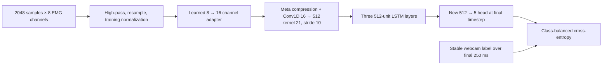

# Webcam-supervised pinch learning

First milestone: a personal decoder for neutral, thumb–index, thumb–middle,
thumb–ring and thumb–pinky pinches. `learning/` implements recording, conservative
pseudo-labeling, dataset quality checks, a causal temporal CNN, feature/motion
baselines, Meta checkpoint transfer, and live camera comparison. Experiments were
run on one wearer's right wrist on November 7, 2026; this record was consolidated
on November 8. This is a CLI/preview workflow, not a dashboard integration.

**Current result:** none of the tested models is a reliable live gesture decoder.
Meta transfer improved development validation scores, but the fresh live run
mostly predicted pinky. Raw recordings, videos, authentication material, model
weights and third-party source remain local under ignored `captures/`; this repo
contains the code, methods and results, not a ready-to-use personal checkpoint.

## Experiment log

The original goal is sequence-to-sequence hand pose and gestures. Everything
actually trained so far predicts one of five stable states: neutral, index,
middle, ring, pinky. MediaPipe Hand Landmarker is pretrained and was not trained
here; geometric thresholds turn its landmarks into camera pseudo-labels. Decoded
gyro and orientation replaced the initially proposed accelerometer/magnetometer
inputs. They are used by the feature-fusion experiment, not the two neural models.

All paths below are relative to `captures/`. Window counts overlap in time and are
not counts of independent gestures. Validation, held-out test, and live camera
agreement are different measurements and should not be ranked against one another.

| Experiment | Local evidence | Result and decision |
| --- | --- | --- |
| Camera preflight, pilot 01 | `pinch-pilot-20261107-01/session.json` | Failed camera access; zero frames. Enabled permission before retrying; no training data. |
| Initial short pilot 02 | `pinch-pilot-20261107-02/quality*.json` | Original rule accepted 62 neutral windows only. Relabeling produced 54 neutral + 9 pinky; still unsuitable for five-class training. |
| Longer pilot 03 and label calibration | `pinch-pilot-20261107-03/quality*.json`, `camera.labels-v2.report.json` | Original rule: 172 windows, neutral/pinky only. Video inspection motivated image/world v2 rules: 314 windows covering all classes. This pilot is calibration data. |
| Fresh v2 pilot 04 | `pinch-pilot-20261107-04/quality.json` | 418 windows: neutral 214, index 57, middle 45, ring 45, pinky 57; zero missing EMG batches. Proceeded to full sessions. |
| Full train/validation/test capture | `pinch-{train,validation,test}-20261107-01/` | Three four-minute recordings; 2,348 / 2,735 / 2,414 accepted windows. Separate recordings and cue-order seeds 101 / 202 / 303. Rewear requested, not independently verified. |
| Small EMG TCN | `pinch-model-20261107-emg-v1/metrics.json` | Best epoch 7: validation accuracy 63.8%, macro F1 0.591. Once-evaluated test accuracy 49.0%, F1 0.459; always-neutral test accuracy 51.7%. Not reliable. |
| Twelve feature/motion candidates | `pinch-model-20261107-features-v1/comparison.json` | Fused logistic selected on 1,446 motion-valid validation windows: 73.4%, F1 0.644. With TCN fallback on all 2,735 windows: 68.7%, F1 0.607. Test recording not reused. |
| Feature model live test | `pinch-live-20261107-01/session.json`, `predictions.jsonl` | Stopped early, about 42 seconds; 127/257 stable comparisons matched (49.4%). 518 predictions: 254 fused, 264 EMG fallback. Offline improvement did not establish live reliability. |
| Official Meta transfer vs scratch | `pinch-model-20261107-meta-transfer-v1/seed-summary.json`, `pinch-model-20261107-meta-transfer-seed{43,44}/report.json` | Three seeds, 555 training and 662 validation contexts. Transfer averaged 76.0% accuracy / 0.683 F1; scratch 50.4% / 0.421. Different optimization schedules; validation-selected, not a new test result. |
| Adapted Meta live test | `pinch-live-meta-20261107-01/live-report.json` | Frozen seed 42; stopped after about 42 seconds. 34/166 stable comparisons matched (20.5%); 470/543 predictions were pinky. No motion input. Clean stream disable and disconnect. |
| Weight, replay and activation audit | `meta-weight-audit/{weights,trace-report,channel-audit}.json` | No nonfinite/collapsed tensors or output-bias explanation. Replay matched 543/543 live and 662/662 validation predictions. Uneven channel shifts and outlier-sensitive normalization; masking channels trades errors rather than repairing the model. |

The two stopped live sessions are diagnostic data, not complete guided evaluations.
Once used for this audit, the Meta live recording must not be reused as an untouched
test of subsequent improvements. No training on these live recordings, robust
normalization repair, multi-placement retraining, Meta motion-fusion branch,
emg2pose checkpoint experiment, or continuous hand-pose model has been completed.

Details below cover [label calibration](#offline-label-calibration-november-7-pilot),
[the first TCN run](#first-three-session-run-november-7),
[feature comparison](#feature-and-motion-comparison-november-7),
[Meta transfer](#meta-checkpoint-transfer-experiment), and
[the weight audit](#weight-and-activation-audit-after-the-first-meta-live-test).

## Setup

Use the Mac and Python environment that already connect to the band (Python 3.11
recommended by the existing driver). From the repository root:

```sh
python -m pip install -r requirements.txt -r learning/requirements.txt
mkdir -p captures/models
```

Download the **Hand Landmarker** task bundle from the official
[MediaPipe models page](https://ai.google.dev/edge/mediapipe/solutions/vision/hand_landmarker#models)
and save it as `captures/models/hand_landmarker.task`. This must be the hand
landmarker, not the gesture recognizer. The recorder uses the documented
[Python video API](https://ai.google.dev/edge/mediapipe/solutions/vision/hand_landmarker/python).
Package ranges are in `learning/requirements.txt`; record your resolved environment
with `python -m pip freeze > captures/environment.txt` for reproducibility.

Close the dashboard's active session and other Bluetooth band clients. Put the
camera where the fingertips remain visible, with good lighting and a plain
background. Keep only the band-wearing hand visible. The preview is unmirrored.
Do a short pilot first; camera handedness and ring/pinky occlusions need checking.

```sh
python -m learning.record BAND_UUID --hand right \
  --model captures/models/hand_landmarker.task \
  --output captures/pinch-pilot --repeats 1 --motion --hold-seconds 5 --rest-seconds 5
python -m learning.dataset captures/pinch-pilot
```

Allow camera/Bluetooth permission if macOS requests it. `--identity-key KEYCHAIN_REFERENCE`
passes an existing enrolled identity to the driver. The recorder does not enroll
or reset the band, or change its handedness setting.

Click the preview and press **Space** when ready; only then does the band connection start. The prompts start after decoded EMG arrives. The pilot command above uses five-second holds and rests (40 seconds total). Relax/open the fingers during
neutral; gently hold the requested fingertip pinch for the displayed countdown.
Hold/rest defaults are three seconds each; the example above uses five. Press **q** to abort; aborted
sessions are deliberately excluded from training. A default session takes about
144 seconds plus connection setup and cleanup.

Check the preview's camera label, then inspect `quality.json` and the video.
Unknown frames are expected during transitions. If a whole class is absent,
change the camera angle, verify hand selection, and inspect landmarks before
collecting more. Thresholds are heuristics, not calibrated contact measurements.
The video is encoded at nominal 30 fps; use frame indices and `camera.jsonl`
timestamps for alignment, never video playback time.

## Record and train

Collect at least three **separate** sessions, preferably 5–10 over several band
placements/days. Remove and re-don the band between sessions. Vary wrist rotation,
arm position and gentle pinch strength within each split. Choose the test sessions
before tuning. Different random seeds change trial order.

```sh
python -m learning.record BAND_UUID --hand right --seed 1 \
  --model captures/models/hand_landmarker.task --output captures/pinch-train
python -m learning.record BAND_UUID --hand right --seed 2 \
  --model captures/models/hand_landmarker.task --output captures/pinch-validation
python -m learning.record BAND_UUID --hand right --seed 3 \
  --model captures/models/hand_landmarker.task --output captures/pinch-test

python -m learning.dataset captures/pinch-train
python -m learning.dataset captures/pinch-validation
python -m learning.dataset captures/pinch-test
python -m learning.train --train captures/pinch-train \
  --validation captures/pinch-validation --test captures/pinch-test \
  --output captures/pinch-model
```

Training rebuilds windows from source recordings. Each split must contain all
five classes. Training sessions alone determine normalization and class weights;
validation macro F1 selects the checkpoint; the test set is evaluated once at the
end. `model.pt` contains weights, normalization and class order. `metrics.json`
contains session paths, training history, test confusion matrix and per-class
recall. Window overlap is allowed within a split, never by randomly splitting
windows from one session. Copies of the same recording still constitute leakage;
do not give them different directory names to bypass the split check.

## What is recorded and what the model learns

- `band.jsonl`: existing driver capture, including device timestamps, sequence
  numbers, missing-batch indicators and new host monotonic receipt timestamps.
  This also contains authentication/session material; keep it local under ignored
  `captures/`.
- `camera.mp4` and `camera.jsonl`: unmirrored video, frame receipt times, all image
  and world landmarks, handedness, visual labels and trial prompts.
- `session.json`: schema, hand, trial schedule, model hash, library versions,
  capture status and clock limitations.
- `windows.npz` / `quality.json`: accepted examples and rejection counts.

The current `image-world-v2` labeler measures thumb-to-fingertip distances
in **image pixels**, normalized by projected palm width, with a looser world-space
distance check. Pixel conversion accounts for non-square video dimensions. The
image close/open thresholds are 0.35/0.55 palm widths; the target world distance
must be below 0.65 and other world fingertip distances above 0.45. A projected palm
narrower than 20 pixels is rejected. Neutral requires every image distance above
0.55 and every world distance above 0.65. Multiple close fingers, missing hands,
and ambiguous geometry are unknown. These are contact proxies, not contact sensors;
projected fingertip overlap can still be wrong.

A candidate must persist for 150 ms before acceptance; unknown detections, class
changes and frame gaps over 150 ms reset the dwell filter. Handedness confidence
is not landmark confidence. The prompt is only a consistency filter, never the
sole ground truth. The first 650 ms and final 350 ms of each cue are excluded.
The recorder saves raw visual, stable and accepted labels, both distance vectors,
image dimensions and label configuration. Live recording and offline relabeling
use the same implementation.

### Offline label calibration (November 7 pilot)

Video review of the longer pilot showed visible index/middle/ring contacts that
the original 0.25-palm-width world-distance rule missed. For example, middle
pinches had image distances around 0.23–0.30 but world distances around 0.47–0.54.
The revised thresholds were selected using this pilot, so **these recordings are
calibration data, not a held-out test set**. Fresh pilot 04 subsequently confirmed
usable examples of all five classes; this did not establish general gesture accuracy.

The original `camera.jsonl`, video and sensor logs are preserved. Recompute labels
and build separate window/quality files with:

```sh
python -m learning.relabel captures/pinch-pilot-20261107-03
python -m learning.dataset captures/pinch-pilot-20261107-03 \
  --labels-name camera.labels-v2.jsonl
```

The relabel command refuses to overwrite an existing output (use `--output-name`
for a new revision). It reconstructs the cue timing and rejects schedule mismatches.
Its report saves the source, session and revised-label hashes; the dataset builder
verifies them before using the sidecar. `--labels-name` also works for training
when all split sessions use that filename. New recordings already use v2 in their
normal `camera.jsonl`, so do not need relabeling.

For the longer pilot, accepted **overlapping** 250 ms windows changed as follows:

| Class | Original | Revised |
| --- | ---: | ---: |
| Neutral | 142 | 137 |
| Index | 0 | 53 |
| Middle | 0 | 48 |
| Ring | 0 | 48 |
| Pinky | 30 | 28 |

These are window counts, not independent trials or accuracy scores. The earlier,
shorter pilot still lacks usable index/middle/ring windows after relabeling; the
code does not manufacture them from prompts. Review images and reports remain
local under ignored `captures/`.

The first model consumes the trailing 512 samples (250 ms) of eight-channel EMG,
removes each channel's window median, scales using training data, and applies eight
causal dilated convolutions followed by a five-class head. Dataset windows advance
62.5 ms. This is a sequence-to-class baseline for stable holds, not yet a full
sequence-to-sequence hand-pose decoder or a calibrated live gesture controller.
Measured results from the real sessions are reported below.

The TCN has eight width-24 Conv1D layers (first layer 8-to-24), kernel size 3,
dilations 1, 2, 4, 8, 16, 32, 64, 128, left padding and ReLU. Layers after the
first have residual connections. The receptive field is 511 samples; a linear
24-to-5 head reads the final timestep. Training uses Adam at 0.001, batch size 64,
30 epochs and seed 42. The loss is cross-entropy with training class weight
`N / (5 * class_count)`; PyTorch's weighted mean divides by the sum of target
weights in that minibatch. Validation macro F1 selects the checkpoint.

Windows crossing dropped batches, device clock discontinuities, large receipt
jitter, camera gaps or uncertain/mixed labels are excluded. Host timestamps are
shared across the camera and probe processes on this Mac, but timestamping occurs
after camera reads and sensor decoding. Bluetooth buffering, camera buffering,
exposure timing and EMG-to-motion delay remain uncalibrated. Device timestamps
preserve cadence but their epoch and batch reference point are not assumed to
match the camera. Stable holds tolerate this better than transitions. No subframe
synchronization claim is made.

## Motion sensors and next stages

The verified decoder exposes raw EMG, gyro and an orientation quaternion. Raw
accelerometer and magnetometer decoding are not established. `--motion` requests
experimental simultaneous EMG + gyro + quaternion without firmware gesture events;
it preserves motion for the feature-fusion baseline; the TCN and Meta network use
**EMG only**.
Check motion counts, drop counts and timing against EMG-only sessions before
relying on this mode. Motion streams may use different device clock epochs.

After the stable-pinch pilot works:

1. Review labels and calibrate timing with repeated visible movements. Add manual
   annotation/relabeling for occlusions and press/release transitions.
2. Add unconstrained negative recordings (typing, gripping objects, wrist motion),
   then evaluate false activations per minute and missed/extra events. Current
   hold-only metrics do not measure those, nor end-to-end latency.
3. Extend the implemented live sensor-only inference with confidence rejection
   and press/release hysteresis; stale-stream rejection already exists. Measure
   EMG-only versus EMG + aligned motion across new band placements.
4. Expand the causal network to produce a label at each timestep, then a separate
   hand-pose head using wrist-relative, scale-normalized landmarks and validity
   masks. Keep session-separated evaluation. Monocular world landmarks are model
   estimates; accurate metric 3D pose would benefit from multi-view/depth capture.

The existing eight-channel unsigned ADC interpretation remains experimental;
electrode mapping and voltage scaling are unverified. Public 16-channel models
are research references, not drop-in weights for this stream.

## Tests

```sh
python -m unittest discover -s learning/tests -v
PYTHONPATH=instrumentation python -m unittest discover -s instrumentation -p 'test_input_service.py' -v
```

Synthetic tests verify labeling, scheduling, missing-data rejection and dataset
shape. Synthetic training can check execution, but cannot establish physiological
signal quality or real pinch recognition accuracy.

## First three-session run (November 7)

Collected three four-minute sessions with EMG, gyro and orientation. The band was
instructed to be removed and re-worn between sessions; this was not instrumented.
Usable overlapping windows: 2,348 training, 2,735 validation, 2,414 test. EMG missing
batches: 0, 2, 0 respectively. Every split has accepted examples from all six
trials of each pinch. Sampled video frames were checked against their labels.

The first EMG-only TCN used the existing 30-epoch configuration and validation
macro F1 for checkpoint selection. Test accuracy was 49.0%, macro F1 0.459. An
always-neutral classifier would score 51.7% accuracy (macro F1 about 0.136), so
this is not a reliable live decoder. Test recall was 49.7% neutral, 15.0% index,
48.5% middle, 59.4% ring and 65.2% pinky. Neutral-to-ring errors and missed index
pinches are major weaknesses. These metrics describe accepted stable windows,
not independent trials, transitions or false activations per minute.

Local artifacts are in `captures/pinch-model-20261107-emg-v1/`: checkpoint, metrics,
summary, environment, source snapshot and source/dataset hashes. Raw sessions are
`pinch-train-20261107-01`, `pinch-validation-20261107-01`, and
`pinch-test-20261107-01`. The test was evaluated once after checkpoint selection.
Future changes should be selected on training/validation data and evaluated on a
new reserved recording before claiming improved generalization. Next investigate
session sensitivity and EMG feature baselines, then compare aligned gyro/orientation
fusion; those motion streams are currently retained but not consumed by the TCN.

## Feature and motion comparison (November 7)

`learning.compare` runs a fixed comparison of four estimators over EMG-only,
motion-only and fused features, using training and validation sessions only.
It does not accept or read a test session. The fitted scaling uses training
features only. Linear discriminant analysis uses the documented
[shrinkage solver](https://scikit-learn.org/stable/modules/generated/sklearn.discriminant_analysis.LinearDiscriminantAnalysis.html);
logistic regression and two RBF SVM settings complete the comparison.

EMG features are window-local: median centering, 1st/99th-percentile clipping,
log RMS, relative channel log RMS, mean absolute value, waveform length and five
frequency bands from 20 to 900 Hz. These summaries are not calibrated voltages.
Motion uses 32 trailing sample-and-hold points on the shared host receipt clock;
no later-arriving sample is used. Gyro statistics and quaternion outer products
are concatenated (the latter are invariant to q/-q and need no component-order
interpretation). Missing samples, device/sequence discontinuities and receipts
older than 100 ms invalidate a motion window. Device epochs are not equated.

```sh
python -m learning.compare --train captures/pinch-train-20261107-01 \
  --validation captures/pinch-validation-20261107-01 \
  --baseline captures/pinch-model-20261107-emg-v1/model.pt \
  --output captures/pinch-model-20261107-features-v1
```

The selected fused logistic model scored validation macro F1 0.644 and accuracy
73.4% on the 1,446 motion-valid windows. The original TCN scored 0.597 and 64.1%
on those same windows. Buffering invalidated motion for 1,289 of 2,735 validation
windows. Using the original EMG model as fallback there gives the honest
full-validation comparison:

| Model | Accuracy | Macro F1 |
| --- | ---: | ---: |
| Original EMG TCN | 63.8% | 0.591 |
| Fused features + EMG fallback | 68.7% | 0.607 |

All twelve candidates below used the same motion-valid subset for fair ablation
(1,248 training windows, 1,446 validation windows). The EMG-only rows here are
therefore not evaluations on all available EMG windows.

| Input | Estimator | Validation accuracy | Macro F1 |
| --- | --- | ---: | ---: |
| EMG | Shrinkage LDA | 46.6% | 0.451 |
| EMG | Balanced logistic, C=1 | 65.5% | 0.543 |
| EMG | Balanced RBF SVM, C=1 | 68.9% | 0.539 |
| EMG | Balanced RBF SVM, C=10 | 69.4% | 0.544 |
| Motion | Shrinkage LDA | 30.8% | 0.259 |
| Motion | Balanced logistic, C=1 | 27.7% | 0.203 |
| Motion | Balanced RBF SVM, C=1 | 30.9% | 0.237 |
| Motion | Balanced RBF SVM, C=10 | 41.6% | 0.240 |
| Fused | Shrinkage LDA | 50.1% | 0.450 |
| Fused | Balanced logistic, C=1 | 73.4% | 0.644 |
| Fused | Balanced RBF SVM, C=1 | 67.4% | 0.519 |
| Fused | Balanced RBF SVM, C=10 | 68.0% | 0.531 |

The selected classifier takes 72 EMG + 39 motion features, standardized with
training-only statistics, then a linear 111-to-5 softmax classifier. There are no
hidden layers. It minimizes class-balanced multinomial log loss with L2 weight
regularization (`C=1`, intercept unpenalized), using scikit-learn's LBFGS solver.
The TCN fallback is separately trained; this is not a jointly trained fusion net.

Index recall remains only 20.7% (previously 21.2%); ring recall drops from 61.7% to
56.2%. Neutral, middle and pinky improve. Motion-only candidates scored poorly,
but posture shortcuts cannot be ruled out. The feature model nearly perfectly
fits training, showing that cross-session generalization is still the challenge.
The same validation session selected the candidate, so these are development
results, not evidence of better test performance. The old test session was not
re-evaluated. Reserve a fresh test after choosing further changes.

Local `captures/pinch-model-20261107-features-v1/` contains `model.joblib`,
`fallback.pt`, `comparison.json`, `summary.json`, predictions, environment and a
source snapshot. `learning.predict_features.predict_windows` reloads these local
trusted artifacts and returns predictions plus a fallback mask; without a fallback
checkpoint, unavailable motion yields -1 (unknown). This batch inference helper
is used by the live decoder described below. Never load untrusted pickle/joblib models.

Next improvements should address capture buffering and collect several training
sessions with repeat band placements and varied postures, particularly index
pinches, instead of further optimizing against this single validation session.

## Live side-by-side test

Add `--predictor captures/pinch-model-20261107-features-v1` to a recording command
to display the frozen band model beside the webcam reference. For an 80-second
test, use `--repeats 2 --hold-seconds 5 --rest-seconds 5`. Press Space in the
preview to start or Q to stop. This mode automatically requests EMG and motion.

`BAND MODEL` uses only sensor windows; no cue or camera input enters the decoder.
The preview shows whether fused features or the EMG fallback produced the result.
Predictions clear on stale data or invalid windows and are logged once per new
sensor window in `predictions.jsonl`. The display is deliberately unsmoothed so
label flicker and wrong predictions are visible.

The running percentage is **camera agreement**, not human-verified accuracy. It
compares only sensor windows bracketed by a stable camera label over 250 ms;
unknown/occluded camera intervals are excluded. It does not use prompt agreement
to assign truth, and repeated video frames do not repeatedly score one prediction.
Host receipt alignment remains approximate. No actions are triggered by predictions.
The camera reference can be wrong, and the result is not interchangeable with
offline validation accuracy or event-level gesture success.

The first feature-model live run (`pinch-live-20261107-01`, seed 404, planned
80 seconds) stopped early after roughly 42 seconds. It produced 518 predictions,
264 through the EMG fallback. Stable camera agreement was 127/257 = 49.4%.
Per-class matches/comparisons: neutral 20/78, index 11/40, middle 67/76, ring 6/35,
pinky 23/28. Stream disable was acknowledged and the band disconnected. These
results did not establish live reliability despite improved offline validation.

## Meta checkpoint transfer experiment

`learning.meta_transfer` adapts the official
[Generic Neuromotor Interface discrete-gesture checkpoint](https://github.com/facebookresearch/generic-neuromotor-interface).
The upstream source and weights are CC-BY-NC-4.0 and remain separate under ignored
`captures/`. The experiment loads the actual upstream architecture and checks all
checkpoint tensor names/shapes strictly. Only explicitly allowlisted model/config
classes are enabled for PyTorch's `weights_only` loader.

Input is one second of eight-channel EMG at 2048 Hz. Accepted endpoints come from
the existing conservative 250 ms camera labels; the earlier context may contain
other gestures. Gaps anywhere in the full second reject that example. Every fourth
accepted endpoint is retained to reduce redundant overlapping examples and runtime.
Training and validation must be distinct recording sessions; there is no test input.

Preprocessing removes each context's median, applies a causal fourth-order 40 Hz
high-pass filter, and resamples 2048 to 2000 Hz with a 125/128 polyphase ratio.
Channel standard deviations are fitted on training contexts only. Standardized
signals are multiplied by 32 before a learned bias-free 8-to-16 pointwise adapter.
That factor is a heuristic initialization near the upstream compression midpoint,
**not a measured conversion to Meta's physical signal units**. No electrode mapping
or missing-channel reconstruction is established. Resampling uses only the trailing
context, with zero-padded boundaries; future streaming code must match this behavior.



The first three pretrained epochs freeze the backbone and disable its dropout;
gradients still propagate through it to the adapter. Nine further epochs fine-tune
the backbone at 1e-4 and adapter/head at 1e-3. The random-initialized control has the
same architecture, adapter/head initialization, examples, minibatch order and
12-epoch budget, but trains the backbone throughout at 3e-4. This is a practical
transfer-versus-scratch comparison, not an isolation of initialization under an
identical optimizer schedule. Both use Adam, gradient clipping at 0.5, and training
class weights N/(5*n_class). Each selects its own best validation macro F1 epoch.
There is no motion branch in this first experiment.

```sh
# Fetch official source and checkpoint once; do not put them in git.
git clone --depth 1 https://github.com/facebookresearch/generic-neuromotor-interface.git captures/meta-gni-source
git -C captures/meta-gni-source checkout b6bf250e2be5a67b23488104335373cdb87a15c9
mkdir -p captures/meta-gni-checkpoint
curl -fL https://fb-ctrl-oss.s3.amazonaws.com/neuromotor-data/checkpoints/discrete_gestures/discrete_gestures.tar \
  -o captures/meta-gni-checkpoint/discrete_gestures.tar
tar -xf captures/meta-gni-checkpoint/discrete_gestures.tar -C captures/meta-gni-checkpoint
python -m pip install -r learning/requirements.txt
python -m learning.meta_transfer \
  --source captures/meta-gni-source \
  --checkpoint captures/meta-gni-checkpoint/model_checkpoint.ckpt \
  --train captures/pinch-train-20261107-01 \
  --validation captures/pinch-validation-20261107-01 \
  --baseline captures/pinch-model-20261107-emg-v1/model.pt \
  --output captures/pinch-model-20261107-meta-transfer-v1
```

Use a new output directory for each run. The output preserves both selected model
states, training normalization, epoch metrics, validation predictions/endpoints,
source snapshots, upstream license/commit, checkpoint and input hashes, and the
dependency environment. Existing TCN performance is measured on exactly the same
validation endpoints. MPS is used when available; `--device cpu` is supported.
This experiment does not replace the live decoder. Single-seed validation-selected
scores are development evidence; a fresh rewear test is still required.

### November 7 transfer results

Three seeds (42, 43, 44), each with 12 epochs, used 555 training contexts and the
same 662 validation contexts. Repeat the command above with `--seed 43` or
`--seed 44` and a new output directory. Each run selects its best validation
macro F1 epoch; these are not independent test estimates.

| Model | Validation accuracy | Validation macro F1 |
| --- | ---: | ---: |
| Meta pretrained, mean across 3 seeds | 76.0% ± 2.6 percentage points | 0.683 ± 0.038 |
| Same architecture from scratch, mean across 3 seeds | 50.4% ± 4.6 percentage points | 0.421 ± 0.044 |
| Existing small TCN on matching endpoints | 64.5% | 0.597 |
| Existing fused features + TCN fallback on matching endpoints | 66.3% | 0.578 |

Variability above is sample standard deviation across seeds, not a confidence
interval across users or recordings. Pretrained macro F1 by seed is 0.664, 0.727,
0.658; scratch is 0.455, 0.437, 0.371. The optimization schedules differ as described
above, so this is evidence for the practical transfer protocol, not a controlled
estimate of the effect of initialization alone.

Mean pretrained recalls are neutral 87.7%, index 34.8%, middle 88.6%, ring 36.3%,
pinky 98.8%. Ring recall regresses from the old TCN's 61.3%; index remains weak.
Pretrained training accuracy is 97.3–98.7%, and scratch reaches 99.8–100%, so the
generalization gap is substantial. No test recording was read and no live model
was replaced. Keep the first predefined seed (42) as the candidate for a fresh
evaluation, rather than choosing the best seed on this validation recording.

Artifacts are in `captures/pinch-model-20261107-meta-transfer-v1/`,
`captures/pinch-model-20261107-meta-transfer-seed43/`, and
`captures/pinch-model-20261107-meta-transfer-seed44/`. The first directory includes
`seed-summary.json` and `existing-feature-comparison.json` for the matched endpoint
comparison. All 26 learning tests passed, and a separate saved-checkpoint smoke
check verified that adapter/head gradients flow while frozen backbone parameters
remain without gradients.

### Live transfer-model test

Use `--meta-checkpoint captures/pinch-model-20261107-meta-transfer-v1/pretrained.pt`
instead of `--predictor` in `learning.record`. The upstream source defaults to
`captures/meta-gni-source` (override with `--meta-source`). `MetaPredictor` loads
the frozen first-seed checkpoint on CPU, uses the exact training preprocessing,
and requires 128 consecutive EMG batches (one second). No gyro, orientation,
camera label, or cue enters this model. The recorder defaults to EMG-only streaming
for this mode. The existing feature-model option is unchanged.

The live buffer rejects discontinuities anywhere in that second and clears the
display on stale data. Camera agreement still uses the final stable 250 ms label
interval, matching the offline target definition. The checkpoint SHA-256 is saved
in the session manifest. Press Space in the preview to start the guided session;
Q stops it and the recorder disables streaming and disconnects. Warm inference
measured approximately 17 ms including preprocessing on the development Mac; this
excludes camera capture, Bluetooth transport, display scheduling, and startup, so it is not
an end-to-end latency measurement.

The first Meta live run (`pinch-live-meta-20261107-01`, seed 71, planned 120
seconds) used the frozen seed-42 checkpoint and stopped after about 42 seconds.
Of 543 predictions, 166 had stable camera references and 34 matched (20.5%).
Per-class matches/comparisons were neutral 9/92, index 4/23, middle 1/16, ring 0/15,
pinky 20/20. Overall predictions were neutral 61, index 11, middle 1, ring 0,
pinky 470. There were no missing EMG batches; disable was acknowledged and the
connection closed cleanly. This failed cross-session result supersedes any claim
that the 76.0% development validation result establishes live accuracy.

### Weight and activation audit after the first Meta live test

The frozen seed-42 model was inspected without retraining. All weights are finite;
the 16-by-8 adapter retains rank 8 (singular values 0.203–1.251). Classifier row
norms are 0.700–0.820, and the pinky bias is -0.032. Removing all classifier biases
leaves every live argmax unchanged. The backbone convolution weights moved 4.8%
in relative L2 norm from Meta's checkpoint; LSTM weight changes are roughly 3.6–5.5%.
There is no obvious corrupted or numerically collapsed weight tensor.

Offline replay reproduces all 543 logged live predictions and all 662 saved
validation predictions. Of the live predictions, 470 (86.6%) are pinky. The failure
therefore reproduces in the model, rather than appearing only in the display or
live preprocessing. Live camera-neutral windows have mean pinky softmax output
91.3%, compared with 0.2% on training-neutral windows. Their mean final hidden
representation is much closer to training pinky than training neutral (Euclidean
distances 5.2 versus 23.3). These softmax outputs are not calibrated confidence.

The input distribution changed unevenly. For example, median one-second filtered
RMS in camera-neutral windows changed from 29.2 to 46.9 ADC counts on channel 2,
27.1 to 38.0 on channel 3, and 44.2 to 91.8 on channel 7. Training channel 4 includes
decoded near-rail outliers: its fitted normalization scale is 171.3 counts while
its median window RMS is 49.0. That exposes sensitivity of the ordinary training
standard deviation to artifacts. Exact electrode/contact/posture causes cannot
be established from weights or these recordings alone.

Diagnostic masking of channel 2 or 3 increases correct neutral classification from
9/92 to 65/92 or 66/92. This is a perturbation result, not validation of a repair;
masking can remove genuine gesture information. Changing global input gain from
0.25x to 4x also fails to recover useful overall camera agreement (15.1–26.5%).
There is no evidence that a single output bias or global amplitude multiplier is
the appropriate fix. Investigate artifact rejection/robust training normalization,
then train and evaluate across independently recorded band placements.

The complete global-gain probe on the 166 camera-comparable live windows was:

| Input gain relative to the trained pipeline | Camera agreement |
| --- | ---: |
| 0.25x | 15.1% |
| 0.5x | 16.3% |
| 1x (unchanged) | 20.5% |
| 2x | 22.3% |
| 4x | 26.5% |

Masking uses zero in the preprocessed channel (one-based channel numbers).
The follow-up check on all camera-comparable classes confirmed the tradeoff:

| Diagnostic condition | Neutral recall | Index recall | Middle recall | Ring recall | Pinky recall |
| --- | ---: | ---: | ---: | ---: | ---: |
| Unchanged | 9.8% | 17.4% | 6.3% | 0% | 100% |
| Mask channel 2 | 70.7% | 0% | 56.3% | 0% | 100% |
| Mask channel 3 | 71.7% | 0% | 100% | 0% | 20% |

Every individual channel was also masked on neutral windows. Correct-neutral
fractions for channels 1 through 8 were 12.0%, 70.7%, 71.7%, 9.8%, 4.3%, 5.4%,
6.5%, 0%. The zero-signal control produced softmax outputs of approximately
6.0%, 7.0%, 47.5%, 31.2%, 8.3% in class order, so the network does not simply
default to pinky for every possible input. All these interventions were offline
diagnostics on the already-failed live recording; none was deployed or retrained.

Audit artifacts are under `captures/meta-weight-audit/`: `weights.json`, the
reproducible `audit.py`, `trace-report.json`, per-split hidden features/logits,
`channel-audit.json`, and diagnostic class-ablation results. The failed live
recording is now diagnostic/development data; it must not be presented as an
untouched test for subsequent changes. No trained checkpoint was altered.
