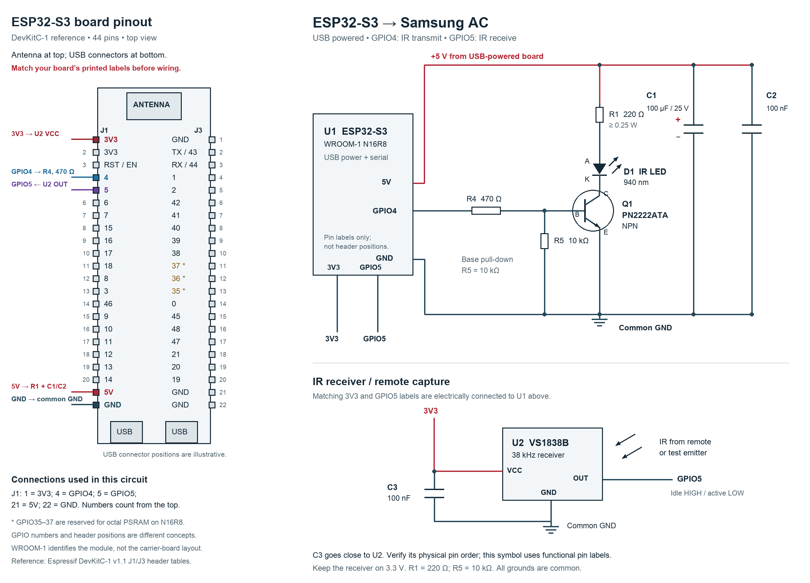
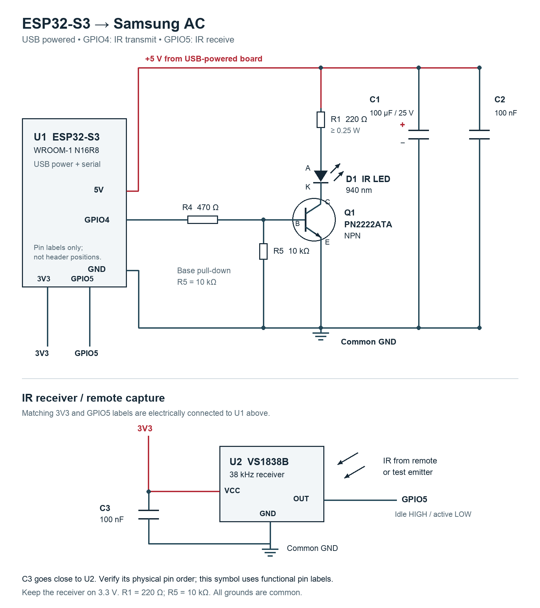
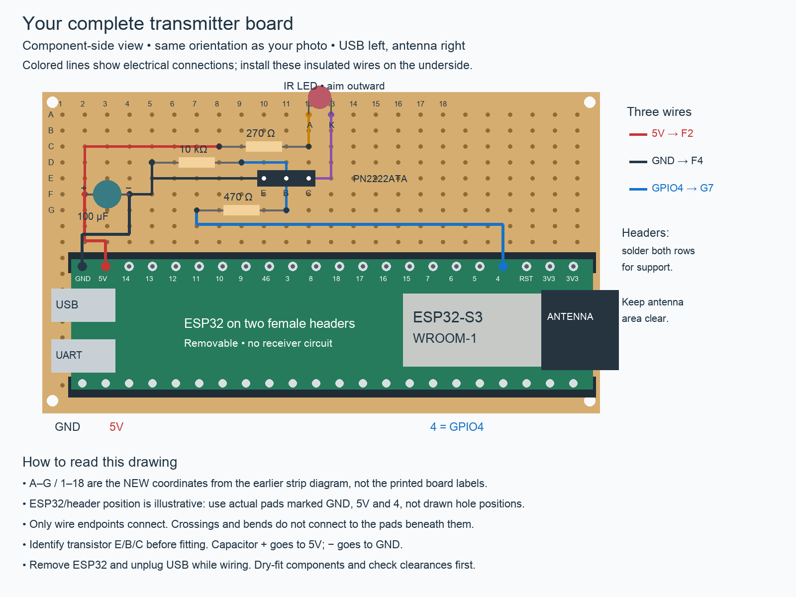

# Samsung AC breadboard remote

## Live board status — 2026-10-17

**Latest:** user confirmed the OFF → ON → OFF sequence works. After a successful
Bluetooth isolation retest, the connected board now runs the combined `band-ac`
build. See [band + AC instructions](../band-probe/AC_CONTROL.md) for gesture
mapping and commands. Live authentication passed, and the user confirmed gesture-to-AC operation.
On 2026-10-18 the user also confirmed the completed perfboard assembly works. This standalone firmware remains available for IR receiver diagnostics.

With explicit user authorization, the connected band board was reused and this
firmware uploaded successfully on `/dev/cu.usbmodem1101`. Upload hashes verified;
live `help`, `status`, `listen on` and `listen off` commands passed. Serial is
115200 baud. Reception was left disabled and no IR command was transmitted.
Remote decoding and AC response still need physical testing. The optional full
flash backup was cancelled at the user's request; no completed new backup exists.
Local verification log: `captures/ac-ir-flash-20261017.log` (ignored by Git).
The band source remains in `firmware/band-probe`; the combined application is
now running on this board.

Standalone test for the purchased ESP32-S3 WROOM-1 N16R8, PN2222ATA and
CentIoT 940 nm IR LED. Remote recorded in the BOM: **DB96-25318J**.
The exact indoor-unit model and its protocol have not yet been verified.
This project does not use the band firmware. Use the second ESP32: uploading
this sketch replaces the application on the selected board. Do not erase the
band board's flash/NVS or provision any owner keys for this test.

## Parts from the purchased BOM

- 1 ESP32-S3, USB data cable, MB102 breadboard, male–female jumpers.
- 1 **emitter** from the IR kit (the kit also contains photodiodes).
- 1 PN2222ATA transistor.
- 1 × 220 Ω resistor, ≥0.25 W: LED current limiting (R1).
- 1 × 470 Ω resistor: base current limiting.
- 1 × 10 kΩ resistor: base–emitter pull-down, from the user’s existing stock.
- 1 × 100 µF electrolytic and 1 × 100 nF ceramic across the supply.
- 1 VS1838B receiver and another 100 nF capacitor (C3).

The user confirmed existing **10 kΩ stock on 2026-10-09**; it was not in the
Robu order. Use one 10 kΩ resistor instead of the earlier two-470 Ω workaround.
With GPIO high, approximately (3.3−0.8)/470 = 5.3 mA leaves the GPIO;
only about 0.08 mA flows through the pull-down, leaving ample base drive.

### Why use an external pull-down?

An internal pull-down can hold the base low once enabled, and the output driver
actively drives GPIO4 LOW between transmissions. The issue is startup/reset:
software configuration is not a guarantee before that software runs. An external
10 kΩ directly between base and emitter remains effective while GPIO4 is high
impedance or the controller is resetting. The ESP32-S3's internal pulls are
weak (typically 45 kΩ), so the external 10 kΩ also provides a firmer idle bias.
A pull-up is the wrong polarity for this active-high NPN driver: it biases it on.
Neither type of pull replaces the **series 470 Ω base resistor**, which limits
GPIO/base current, or the LED's series resistors.

For **GPIO5 receive**, the situation is different: the VS1838B output idles high.
The firmware enables the ESP32's internal pull-up via `enableIRIn(true)`;
no external receiver pull-up is specified for this short-wire bench circuit.
Do not enable a pull-down on that active-low receiver output.

2026-10-17: use a single standard **220 Ω** resistor in place of three 68 Ω
resistors (204 Ω). This slightly reduces current; firmware needs no change.

The anonymous kit emitter has no verified current rating. Start with 220 Ω,
not the historical single-68 Ω proposal: at nominal 5 V, Vf=1.3 V and
VCE=0.2 V, LED current is about **16 mA during carrier ON pulses**.
At 5.25 V, Vf=1.2 V, VCE=0.1 V and −5% resistor tolerance, about 18.9 mA.
Total resistor dissipation is under 0.08 W even continuously at that estimate.
This is a conservative test point, not a verified LED rating. Do not increase
current based on an unverified seller pulse-current claim; first check polarity,
protocol, alignment and distance. Each additional LED needs its own driver branch.

## Circuit



[Combined wiring sheet (SVG)](diagrams/samsung-ac-ir-wiring.svg) ·
[Board pinout close-up](diagrams/esp32-s3-ir-pinout.png)

The physical pinout is the **44-pin Espressif DevKitC-1 reference**, viewed from
the component side with the antenna at the top and USB connectors at the bottom.
The delivered Robu carrier revision has not been physically verified; match its
printed labels before using these positions. WROOM-1 N16R8 identifies the module,
not a unique carrier pinout. USB connector drawings are illustrative.

| Connection | Left header J1 position, counting from the top | Destination |
| --- | ---: | --- |
| 3V3 | 1 (or 2) | VS1838B VCC and C3 |
| GPIO4, marked 4 | 4 | R4 470 Ω → transistor base |
| GPIO5, marked 5 | 5 | VS1838B OUT |
| 5V | 21 | R1 220 Ω and supply capacitors C1/C2 |
| G / GND | 22 | Common circuit ground |

All GND pins connect to the same ground. GPIO35–37 are reserved for octal PSRAM
on the N16R8 module; this circuit does not use them.
[Reference pin tables](https://docs.espressif.com/projects/esp-dev-kits/en/latest/esp32s3/esp32-s3-devkitc-1/user_guide_v1.1.html#header-block).



[Scalable SVG schematic](diagrams/samsung-ac-ir-schematic.svg). Component
R1 is the LED resistor, R4 the base resistor, and R5 the
base–emitter pull-down. The schematic shows electrical connections; the
breadboard placement table below identifies the physical holes.


The transistor emitter goes directly to
ground; collector sinks the LED current. The GPIO drives only the base resistor.
The onsemi **PN2222ATA** datasheet shows E–B–C for the pictured package
(flat face toward you, leads downward). Check the actual marking and package
against that drawing before wiring: P2N2222A and other “2222” parts can differ.
Do not infer the pinout from the generic transistor name.

Use GPIO **4**, not header position 4. GPIO5 is reserved here for optional RX.
These GPIOs are available on the Espressif DevKitC-1 reference design; verify
the silkscreen on the delivered Robu board. No PSRAM configuration is needed.

## Breadboard placement

Keep the ESP32 **beside** the breadboard and connect its header using the
purchased male–female leads. This avoids the wide board covering useful holes.
On a normal MB102, holes A–E in each numbered row are connected; F–J form a
separate group. Adjacent row numbers are isolated. Verify this with continuity.
Use only one uninterrupted segment of each side rail, or bridge split rails.

This example uses the left A–E half. Form the transistor leads gently to reach
three separate rows; never place all three leads in one connected row.

| Connection / part | Breadboard holes |
| --- | --- |
| Transistor emitter E | E10 |
| Transistor base B | E11 |
| Transistor collector C | E12 |
| ESP32 GND lead | A10 |
| ESP32 GPIO4 lead | A15 |
| 470 Ω base resistor | B15 → B11 |
| 10 kΩ pull-down R5 | C11 → D10 |
| ESP32 5V lead | A20 |
| 220 Ω LED resistor R1 | B20 → B24 |
| IR LED | anode E24 → cathode A12 |
| 100 µF capacitor | + C20 → − C10 |
| 100 nF capacitor | D20 → B10 |

Rows 10 and 20 are the ground and 5 V nodes in this layout; no rail jumper is
required. If capacitor leads do not reach, extend them with insulated connections
or use equivalent power rails; do not strain components or leave crossing bare
leads. For the LED connection, a purchased female–female lead can extend one
leg. Keep the base/collector wiring short. The table specifies **electrical lead
identity**, not an assumed orientation of an unidentified transistor.

Disconnect USB while assembling. Inspect polarity/shorts, then USB-power the
ESP32 alone and measure its labelled 5V and GND pins before attaching the LED
circuit. Some clone boards do not expose USB power at that pin without a jumper;
if it is not approximately 5 V, check that board's power path before proceeding.
Use one USB supply for this test; do not attach an independent 5 V supply in
parallel. This breadboard only handles low voltage: no AC mains connection.

## Build and upload

From the repository root, with PlatformIO installed:

```sh
pio run -d firmware/ac-ir-test
pio device list
pio run -d firmware/ac-ir-test -t upload --upload-port /dev/cu.YOUR_SECOND_ESP32
pio device monitor -b 115200 --port /dev/cu.YOUR_SECOND_ESP32
```

If `pio` is not on PATH, use your virtual environment's `bin/pio` instead.
This session's build tool is `/tmp/neural-ir-build-venv/bin/pio` (temporary).

Close Arduino Serial Monitor before uploading, and use only one serial monitor
at a time. Select the **second board's** actual port; the band board's historical
port is deliberately not hard-coded. Use the native USB port, with the supplied
configuration enabling ESP32-S3 hardware USB CDC. If upload cannot connect,
hold BOOT, tap RESET, release BOOT, then retry on the enumerated port.

Arduino IDE alternative: open `ac-ir-test/ac-ir-test.ino`, install
**IRremoteESP8266 2.8.6** and **esp32 by Espressif Systems 2.0.17**,
select ESP32S3 Dev Module, Flash Size 16 MB, PSRAM Disabled,
USB Mode Hardware CDC and JTAG, USB CDC On Boot Enabled, and the native USB port.
The pinned Arduino 2.x core is intentional; do not assume Arduino 3.x compatibility
for this library version. PlatformIO is the reproducible build path.

## Commands and first test

Open serial at **115200 baud**; send `help` if the startup banner was missed.
Commands ignore case and surrounding spaces. CR, LF, CRLF work; with no line
ending, 300 ms without another byte completes a command. Send one at a time.

| Command | Effect |
| --- | --- |
| `on` | Send extended power-on state: initially Cool, 24 °C, Auto fan, swing off |
| `up` or `+` | Increase requested setpoint 1 °C (less cooling), while locally on |
| `down` or `-` | Decrease requested setpoint 1 °C (more cooling), while locally on |
| `temp 23` | Set requested temperature to 23 °C, while locally on |
| `off` | Send extended OFF → ON → OFF, with 1-second pauses between frames |
| `off single` | Send one extended OFF frame (previous behavior) |
| `off legacy` | Diagnostic: send the older fixed Samsung OFF frame |
| `status` | Print local requested settings; transmit nothing |
| `listen on` / `listen off` | Enable/disable remote capture on GPIO5; off also disables loopback |
| `loopback on` / `loopback off` | Opt-in self-reception; on enables listening, off retains listening |

There is **no automatic IR transmission at startup**. Power is unknown after
reset; temperature commands require an explicit `on` first. Valid range is
16–30 °C; out-of-range commands are rejected. Repeating `on` sends an explicit ON frame; repeating `off` repeats the full
OFF → ON → OFF sequence, including its temporary ON step. `on` retains the last local
setpoint until reset, which restores 24 °C. There is no persistence or AC feedback.

1. Start 0.5–1 m from the indoor unit, aiming the emitter at its IR window.
2. Send `on`; check the AC's beep/display and selected cooling temperature.
3. Send `temp 24`, `down`, `up`; verify displayed 24 → 23 → 24 °C.
4. Send `off`; it sends OFF → ON → OFF to cancel this unit’s cleaning cycle.
   Keep the emitter aimed throughout the approximately 3-second sequence.
   Check the display/beeps and final shutdown rather than compressor startup.
5. Reset the ESP32: it must send nothing. `up` must report “Send on first”.
6. Test range only after these work, and record position/distance and outcomes.

Samsung commands contain a full state, not universal “temperature up” codes.
This bench remote intentionally selects cooling/auto fan/swing off and uses
library defaults for other features, including disabled timers. The physical
remote's display will not update when this ESP32 sends. Using that remote can
make the ESP32's requested state stale; resend `on` plus a chosen temperature
to establish a known test state. Captures below do not automatically synchronize it.

## Receiver wiring and original-remote capture

Connect the **VS1838B demodulating receiver**, not the kit's bare photodiode:
VCC to **3V3**, GND to common ground, OUT to GPIO5, with 100 nF across VCC/GND
at the receiver. The unused right F–J half of the MB102 can hold it:

| Receiver connection | Breadboard hole / connection |
| --- | --- |
| U2 OUT | F29; ESP32 GPIO5 jumper to I29 |
| U2 GND | F30; another ESP32 GND jumper to I30 |
| U2 VCC | F31; ESP32 3V3 jumper to I31 |
| C3 100 nF | H30 → H31, immediately beside U2 |

Place the three **identified** leads in these separate rows; the table is not
an assertion about the package's left-to-right pinout. Row 30 connects to the
same common ground through the ESP32's GND pins. These rows use no power rails.

Verify the supplied receiver's pin diagram before powering it;
commonly OUT–GND–VCC faces forward, but this guide does not assume the delivered
part's orientation. Use a receiver documented for 3.3 V operation. Do not feed
a 5 V receiver output into an ESP32 pin.

Send `listen on`, point the original remote at the receiver and press Power,
then set Cool/24/Auto, then Temp −, Temp +, and Power off. Save the serial output.
Expected protocol is **SAMSUNG_AC**; both 112-bit (14-byte) normal and 168-bit
(21-byte) extended frames are valid. Power changes commonly use extended frames.
The sketch prints decoded settings, state bytes and raw timings for comparison.
If UNKNOWN or overflow is reported, retain the raw output and check receiver
pinout, supply, ambient light and spacing before changing protocols.

In normal `listen on` mode, reception pauses during this board's transmissions.
For an **experimental same-board emitter check**, send `loopback on`, then `on`
or `temp 24` (after turning on), one command at a time. Aim the LED toward the
receiver or bounce light from a nearby surface; start with tens of centimetres
of separation rather than pressing them together. Expect a following `RX`
report with `SAMSUNG_AC` and matching requested settings. Send `loopback off`
to restore normal remote capture, or `listen off` to disable both.

Loopback stays enabled until disabled or reset. A transmission clears stale RX
capture first. It can still receive unrelated IR, and it does not distinguish
sources. There is no automatic retry or test pass/fail assertion. Sending `on`
in this test can also reach and operate the AC.

The library generates the carrier in software; receiving interrupts on the same
ESP32 can disturb transmit timing. Therefore a missing or malformed loopback
capture is inconclusive. For independent frame validation, move the receiver to
a second ESP32 running `listen on` and transmit from the first. Power that
receiver from its own board's 3V3/GND; the optical link needs no ground wire
between boards. Do not overwrite the band board just to perform this check.

The VS1838B demodulates the carrier: it reports burst/space timing and decoded
frames, **not** the actual 38 kHz carrier frequency, duty cycle or LED current.
Use a scope/logic analyzer at GPIO4 to inspect electrical carrier timing (or a
suitable photodetector to measure optical timing). A phone camera may reveal
flashes, but cannot validate frames or timing. None of these checks confirms
that the AC received the command.

## Validation and references

2026-10-17 OFF diagnosis: user confirms ON and temperature work, but the fixed
`sendOff()` frame does not shut down this AC. The revised source uses
`setPower(false)` + `sendExtended()` for `off`, retaining the original frame as
`off legacy`. Build and upload passed after the serial monitor was closed; live `help`
confirmed the revised firmware. No IR command was sent during verification.
Appliance OFF behavior remains to be verified. Local serial evidence:
`captures/ac-ir-off-revision-20261017.log`.

Hardware assembly, LED current, emitted timing, AC compatibility and range still
require bench verification. See the build result recorded below; successful
compilation alone does not establish appliance control.

2026-10-09: PlatformIO build including receiver pull-up and loopback **passed** for `esp32-s3`, using Espressif32 6.12.0,
Arduino-ESP32 2.0.17 and IRremoteESP8266 2.8.6. Flash: 451,797 bytes; static RAM:
19,504 bytes. No board was flashed and no appliance commands were sent.

- [Purchased inventory](../../docs/home-control-bom.md)
- [onsemi PN2222A / PN2222ATA datasheet](https://www.onsemi.com/pdf/datasheet/pn2222a-d.pdf)
- [Espressif DevKitC-1 reference GPIO/power guide](https://docs.espressif.com/projects/esp-idf/en/v5.0/esp32s3/hw-reference/esp32s3/user-guide-devkitc-1.html)
- [Pinned Samsung implementation and extended-power handling](https://github.com/crankyoldgit/IRremoteESP8266/blob/v2.8.6/src/ir_Samsung.cpp)
- [Library Samsung example](https://github.com/crankyoldgit/IRremoteESP8266/blob/v2.8.6/examples/ControlSamsungAC/ControlSamsungAC.ino)

- [ESP32-S3 datasheet: internal pulls and reset pin configurations](https://www.espressif.com/sites/default/files/documentation/esp32-s3_datasheet_en.pdf)
- [VS1838B manufacturer datasheet, distributor-hosted](https://www.electronicoscaldas.com/datasheet/VS1838B_LFN.pdf)

## Cleaning-cycle shutdown sequence — 2026-10-17

The user confirmed generated extended OFF works, but the AC starts a cleaning
cycle (display reportedly shows “1%”). Their manual OFF → ON → OFF sequence
stops it. `off` now sends that sequence with 1-second pauses after the first two
frames; those pauses are an initial choice requiring appliance verification.
Each frame retains local temperature/mode/fan settings and the final local power
state is OFF. Keep the emitter aimed for the entire sequence. Serial commands
are processed after the sequence finishes. `off single` preserves the prior
single-frame behavior, and `off legacy` remains a diagnostic fixed frame.
The sequence runs even if local power already says OFF, because local state is
not appliance feedback. There is no automatic retry if a frame is missed.

Build/upload and live help verification passed for the sequence revision on
2026-10-17. No IR command was sent during verification. Log:
`captures/ac-ir-off-sequence-20261017.log`. The user subsequently confirmed the AC responds correctly to this sequence.


## Working transmitter-only perfboard — 2026-10-18

User confirmed the finished assembly works. The ESP32 is removable in two rows
of female headers on the same 5 × 7 cm isolated-pad board. USB is on the left,
antenna on the right, and transmitter components occupy the strip above it.
The receiver is omitted. The final LED resistor is **270 Ω**; the base resistor
is 470 Ω, the base–emitter pull-down is 10 kΩ, and the supply capacitor is
100 µF with positive to 5V and negative to GND.



[Scalable full view](diagrams/samsung-ac-perfboard-full.svg) ·
[Component and mirrored solder sides](diagrams/samsung-ac-perfboard.png) ·
[Scalable placement](diagrams/samsung-ac-perfboard.svg)

These drawings use their own A–G / 1–18 coordinates, not the board silkscreen.
The full-view ESP32/header position is illustrative: connect by actual 5V,
GND and GPIO4 labels. Colored lines represent insulated underside wires;
crossings and intermediate pads are not junctions. Identify transistor leads
before fitting; remove the ESP32 and USB power while soldering.
